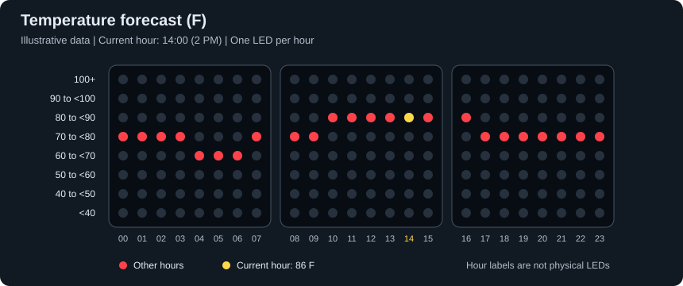
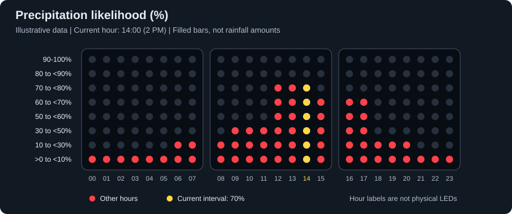

# WeatherClock - CircuitPython Temperature and Rain Forecast Clock

A WiFi-connected clock that alternates between **today's temperature forecast in
degrees Fahrenheit** and **precipitation likelihood** on three 8x8 bicolor LED
matrices. Each view is displayed for **10 seconds** by default. It uses the free NOAA
National Weather Service (NWS) API, not the former tide-prediction API.

## Reading the Display

Each column represents a fixed local hour, from midnight on the left to 11 PM
on the right. Temperature uses **one LED per plotted hour**; precipitation uses
**filled vertical bars** from the bottom through the probability's row.

### Temperature View

| Physical LED row | Temperature (Fahrenheit) |
|---|---|
| Top (row 7) | 100 F and above |
| Second from top (row 6) | 90 to below 100 F |
| Row 5 | 80 to below 90 F |
| Row 4 | 70 to below 80 F |
| Row 3 | 60 to below 70 F |
| Row 2 | 50 to below 60 F |
| Row 1 | 40 to below 50 F |
| Bottom (row 0) | 30 to below 40 F; colder temperatures also clamp here |

The scale is **fixed**, not normalized to the day's minimum and maximum.
For example, 79.9 F uses row 4; 80 F uses row 5.

#### Example on the Matrices



This invented but realistic warm-day forecast dips to **68 F at 5 AM**, peaks at
**88 F at 1 PM**, and eases to **72 F at 11 PM**. At the illustrated current time,
**2 PM**, the **86 F** forecast lights one yellow LED in row 5. Other hours are
red. Each group of eight columns is one physical matrix; the scale, hour labels,
and legend are explanatory annotations, not part of the LED display.

### Precipitation Likelihood View

| Physical LED row | Precipitation likelihood |
|---|---|
| Top (row 7) | 90-100% |
| Second from top (row 6) | 80 to below 90% |
| Row 5 | 70 to below 80% |
| Row 4 | 60 to below 70% |
| Row 3 | 50 to below 60% |
| Row 2 | 30 to below 50% |
| Row 1 | 10 to below 30% |
| Bottom (row 0) | Greater than 0 to below 10% |
| No LED | 0%, or an unavailable value |

The entire current-hour bar is yellow **only if its probability is above 0%**.
For example, 1% lights the bottom row, 20% fills rows 0-1, and 60% fills rows 0-4.
An entirely dry
forecast is a valid blank display. If *all* precipitation values for today are
unavailable, the rain view shows the red error X rather than looking like a
confirmed dry day. The serial log distinguishes 0% from unavailable values.

These are probabilities of **precipitation**, not rainfall amounts or observed
rainfall. A multi-hour probability is repeated across its covered hour columns;
it is the chance for the **enclosing forecast interval**, not independent odds
for every hour. The display does not invent finer timing than the API provides.

#### Example on the Matrices



For the same sample day, the chance of precipitation is low overnight, rises
around midday, and falls again in the evening:

| Local hours | Sample interval probability |
|---|---|
| 00-05 | 5% |
| 06-08 | 10% |
| 09-11 | 30% |
| 12-14 | 70% |
| 15-17 | 60% |
| 18-20 | 20% |
| 21-23 | 5% |

At **2 PM**, the **70%** interval fills rows **0-5** with yellow LEDs. The same
interval probability is repeated in the noon and 1 PM columns in red. Even the
5% intervals light the bottom row; a 0% interval would be completely dark.
These are illustrative values, not a live NWS forecast or rainfall totals.
Both diagrams show a successful refresh with a full day's forecast retained.

### Hours, Colors, and Cached Data

| Matrix | I2C address | Hours, left to right |
|---|---|---|
| Left | `0x70` | 00-07 |
| Center | `0x71` | 08-15 |
| Right | `0x72` | 16-23 |

- **Yellow:** the current hour's forecast.
- **Red:** other available hourly forecasts.
- **Green:** cached forecasts for today after a refresh failure; the current hour
  remains yellow.
- **Blank column:** no forecast is available for that hour. Missing values are
  never treated as zero degrees. In the rain view, 0% also leaves the column dark.

Past, current, and future hours use the same configured brightness in both views.
Per-hour dimming is not implemented.

NWS forecasts may omit hours that have already passed. At startup those columns
stay blank. While the clock remains running, it retains the predictions it
previously received for elapsed hours on the same day. Those retained values are
**forecasts, not observations**, for both temperature and precipitation. This cache
is in RAM and is lost on restart. Yesterday's data is never reused as today's forecast.

## Hardware

- CircuitPython-compatible WiFi microcontroller. The existing hardware setup was
  tested on an **Adafruit Feather ESP32 V2 with CircuitPython 10.0.3**.
- Three HT16K33 **8x8 bicolor** LED matrices at addresses `0x70`, `0x71`, `0x72`.
- I2C wiring and an internet connection.

The raw NWS grid response can be hundreds of kilobytes and is decoded in memory.
A board with sufficient free heap is required; lower-memory boards may report
`MemoryError`. Forecast parsing and display cycling have host-side tests, but the
forecast path still needs an on-device smoke test for available heap, network
behavior, and physical LED orientation.

## Installation

1. Install CircuitPython for your board.
2. Install the libraries in `requirements.txt` using the Adafruit CircuitPython
   bundle matching your firmware, or use `circup`:

   ```sh
   pip install circup
   circup install adafruit_ht16k33 adafruit_requests adafruit_ntp
   ```

   Required libraries in `CIRCUITPY/lib/` include:

   - `adafruit_ht16k33/`
   - `adafruit_requests.mpy`
   - `adafruit_ntp.mpy`
   - `adafruit_bus_device/`
   - `adafruit_connection_manager.mpy`

3. Copy **`code.py`, `forecast.py`, `error_log.py`, and `boot.py`** into the
   board filesystem root. Copy `boot.py` last, then perform a physical reset.
4. Configure `settings.toml` as below, then restart the board.

## Configuration

```toml
WIFI_SSID = "your_wifi_network"
WIFI_PASSWORD = "your_wifi_password"

# Optional fallback networks, tried in order.
# WIFI_SSID_2 = "another_network"
# WIFI_PASSWORD_2 = "another_password"
# WIFI_SSID_3 = "third_network"
# WIFI_PASSWORD_3 = "third_password"

# Default: Miami, FL.
WEATHER_LATITUDE = "25.6936"
WEATHER_LONGITUDE = "-80.4517"

# NWS requires an application-identifying User-Agent. Contact info is optional.
WEATHER_USER_AGENT = "WeatherClock/1.0"

NTP_SERVER = "time.google.com"
TIMEZONE_OFFSET = -5
DST_AUTO = "1"

LED_BRIGHTNESS = "0.3"
DISPLAY_DUMP = "0"
```

### Location and Time Zone

Set `WEATHER_LATITUDE` and `WEATHER_LONGITUDE` to your desired location within
NWS forecast coverage, primarily the United States and its territories.
The former `TIDE_STATION` setting is no longer used. Station `8726724` is
**Clearwater Beach**, not St. Petersburg as previously documented.

Also set the time zone for that location:

- `TIMEZONE_OFFSET`: standard-time offset from UTC, e.g. Eastern `-5`, Central
  `-6`, Mountain `-7`, Pacific `-8`.
- `DST_AUTO = "1"`: add one hour during US daylight saving time.
- `DST_AUTO = "0"`: disable daylight saving adjustments, e.g. for most of Arizona
  or Hawaii. The clock does not infer a time zone from the coordinates.

The device synchronizes its local clock using NTP at startup and daily at 3 AM,
and checks daylight saving transitions in the main loop.
Forecast validity timestamps are converted from their UTC offsets into the
configured local time. Spring's nonexistent hour remains blank; fall's repeated
hour shares one column and the later forecast interval wins. The display always
has 24 fixed hour columns.

### Brightness and Serial Mirror

`LED_BRIGHTNESS` controls all three matrices from `0.0` (off) to `1.0` (full).
Set `DISPLAY_DUMP = "1"` to print timestamped, colored 24x8 snapshots to the serial
console at display changes. Rows print top to bottom; physical row 0 is at the
bottom. Set it to `"0"` to disable the snapshots. The serial forecast chart and
numeric Fahrenheit readings and precipitation percentages are still logged on
successful fetches.

### View Switching

Change the constant near the top of `code.py` to set seconds per view:

```python
DISPLAY_SWITCH_INTERVAL = 10
```

It must be positive. The clock starts with temperature, switches to precipitation
after 10 seconds, and returns to temperature after another 10 seconds. This is a
code constant, not a `settings.toml` option.

View switching is independent of hourly fetching and does **not** trigger extra
API requests. It continues while waiting for a scheduled retry using today's
cached data. Blocking network requests, immediate retries, and time synchronization
can pause switching; after a delay, the clock advances to the currently scheduled
view rather than rapidly replaying missed transitions.

## Data Fetching and Updates

1. Look up `https://api.weather.gov/points/{latitude},{longitude}`.
2. Follow its `properties.forecastGridData` URL. This works for coastal marine
   grids as well as land grids; coastal locations may not support the separate
   `/forecast/hourly` endpoint.
3. Read `properties.temperature` and `properties.probabilityOfPrecipitation` from
   the **same response**, expand each `validTime` interval into its covered hours,
   convert Celsius to Fahrenheit when necessary, and keep only the current local
   calendar day. Precipitation probabilities use `wmoUnit:percent`.

The point-to-grid mapping is cached in RAM and refreshed daily or after a
request failure. The API requires no key or paid subscription; requests include
the configured `User-Agent`.

- **Startup:** fetch today's forecast.
- **Hourly:** refresh the forecast and update the current-hour highlight.
- **Midnight:** clear the previous day's data and fetch the new day's forecast.
- **Failed fetch:** retry up to three times with watchdog-fed backoff. After
  these attempts, retry after 5, 15, or 30 minutes as failures accumulate.
  A new hour also triggers a refresh.
- **Recovery:** immediately redraw fresh data after a successful retry.

The main loop checks at least once per second while idle. Network requests and their
immediate retries can delay updates while in progress.

### Failure Indicators

- During a fetch, the top-right pixel of the left matrix briefly shows status:
  yellow while fetching, green for success, red for failure. The next chart
  redraw restores this pixel to its forecast role.
- If today's cached forecast exists, a failed refresh displays it in green.
- Without usable data for today, a red X appears on the center matrix.
- After five failed fetch cycles, yellow borders indicate safe mode.
- Successful fetching exits safe mode and restores the normal chart.
- Missing or malformed precipitation data is explicitly logged and does not stop
  temperature updates. If no precipitation probabilities are available for today,
  only the rain view shows the error X; the temperature view still displays normally.

The boot sequence is unchanged: corner LEDs show matrix/WiFi/NTP progress, then
the date (`MM / DD`) and time (`HH : MM`) each appear for about three seconds.

### Persistent Failure Logs

Failures are printed to serial and appended to `/weatherclock.log`, including
WiFi/NTP errors, failed weather attempts, precipitation parsing errors, retry
schedules, safe-mode entry, main-loop exceptions, and recovery. Each entry has
local date/time and uptime; dates before a successful NTP sync may be incorrect.
A startup entry marks each application restart. Normal chart dumps are not
written to flash.

The current log rotates to `/weatherclock.log.1` before exceeding 32 KiB; only
these two files are retained (at most 64 KiB total). Messages are capped at 512
UTF-8 bytes and each append is closed immediately. Logs survive resets, although
an unexpected power loss can lose the last write or damage the filesystem.
Repeated failures still cause flash wear; this is diagnostic logging, not an
unlimited archive. If storage is read-only or full, a serial warning is emitted
once and file logging is disabled until the application restarts.

`boot.py` always gives CircuitPython filesystem write access for logging; there
is no button-selected edit mode. USB serial access is unaffected. Never bypass
filesystem ownership checks to allow simultaneous host/application writes.

The Feather ESP32 V2 has a USB-to-serial converter, **not a USB mass-storage
`CIRCUITPY` drive**. After connecting a serial REPL, stop the application with
Ctrl-C and read the saved logs:

```python
with open("/weatherclock.log") as log:
    for line in log:
        print(line, end="")
```

Repeat for `/weatherclock.log.1` if it exists. Resetting does not delete either
file. Connecting serial alone shows live messages, not saved log contents.
On boards with native USB, the mounted drive is read-only to the computer.
For host-side file updates, enter CircuitPython safe mode (which skips
`boot.py`) using your board's documented procedure, then physically reset after
editing to resume logging.

## API Example

NWS raw grid temperature data has this shape:

```json
{
  "properties": {
    "temperature": {
      "uom": "wmoUnit:degC",
      "values": [
        {
          "validTime": "2026-10-24T18:00:00+00:00/PT2H",
          "value": 25
        }
      ]
    },
    "probabilityOfPrecipitation": {
      "uom": "wmoUnit:percent",
      "values": [
        {
          "validTime": "2026-10-24T18:00:00+00:00/PT2H",
          "value": 60
        }
      ]
    }
  }
}
```

This predicts 77 F throughout the two-hour interval starting at 18:00 UTC.
With Eastern daylight time configured, it lights row 4 in the 14:00 and 15:00
columns. Intervals exclude their end time. Null values leave hours blank.

The precipitation view fills rows 0-4 at those same two columns for the 60%
probability covering that two-hour interval. No rainfall accumulation in inches
is displayed.

Official references:

- [NWS API documentation](https://www.weather.gov/documentation/services-web-api)
- [Default location lookup](https://api.weather.gov/points/25.6936,-80.4517)

## Project Structure

```text
WeatherClock/
|-- code.py                       # CircuitPython application and matrix rendering
|-- boot.py                       # Filesystem write access for persistent logging
|-- error_log.py                  # Bounded persistent failure logging
|-- forecast.py                   # Forecast parsing, time conversion, fixed bands
|-- settings.toml                 # WiFi, coordinates, time zone, display settings
|-- requirements.txt              # CircuitPython libraries
|-- README.md
`-- tests/
    |-- test_error_log.py          # Rotation, write failures, logging boot setup
    |-- test_precipitation_forecast.py # Host-side parsing and threshold tests
    |-- test_temperature_display.py # Host-side mocked hardware/network tests
    |-- serial_temperature_display.py # CircuitPython serial-only forecast check
    |-- blinktest.py               # Hardware LED test
    |-- matrixtest.py              # Hardware matrix test
    `-- simple_tide_display bar chart.py # Historical tide prototype, not the clock
```

The historical tide bar-chart prototype is retained for reference only. It does
not use the new forecast configuration or temperature bands.

## Validation and Troubleshooting

Run automated tests on a computer with Python 3 (no CircuitPython packages needed):

```sh
python3 -m unittest discover -s tests -p 'test_*.py' -v
```

For a serial-only check on the board, copy `tests/serial_temperature_display.py`
beside `code.py`, `forecast.py`, and `error_log.py`, then run it manually from the CircuitPython
REPL. It uses the same settings and forecast-fetching code without initializing
the LED matrices. Normal startup still runs `code.py`.

For hardware checks, use `tests/blinktest.py` and `tests/matrixtest.py`.

| Problem | Check |
|---|---|
| Matrix setup failed | I2C wiring, bicolor matrix type, unique addresses |
| Network setup failed | WiFi settings and signal |
| NWS HTTP error | Connectivity, coordinates, API coverage/status; see logged status and URL |
| No forecast for local day | Time/NTP, time-zone settings, NWS data availability |
| Missing early-hour columns | Expected after startup if NWS no longer supplies those hours |
| Unexpected hour placement | `TIMEZONE_OFFSET` and `DST_AUTO` must match the forecast location |
| `MemoryError` | Free heap/board capacity for the raw grid JSON response |
| Time sync failed | NTP access; the existing system clock is retained and the error is logged |

Do not commit or share WiFi passwords.
